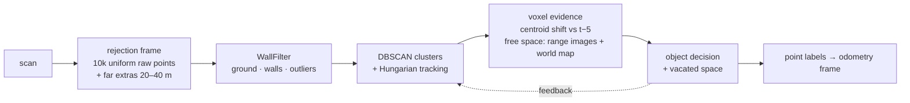
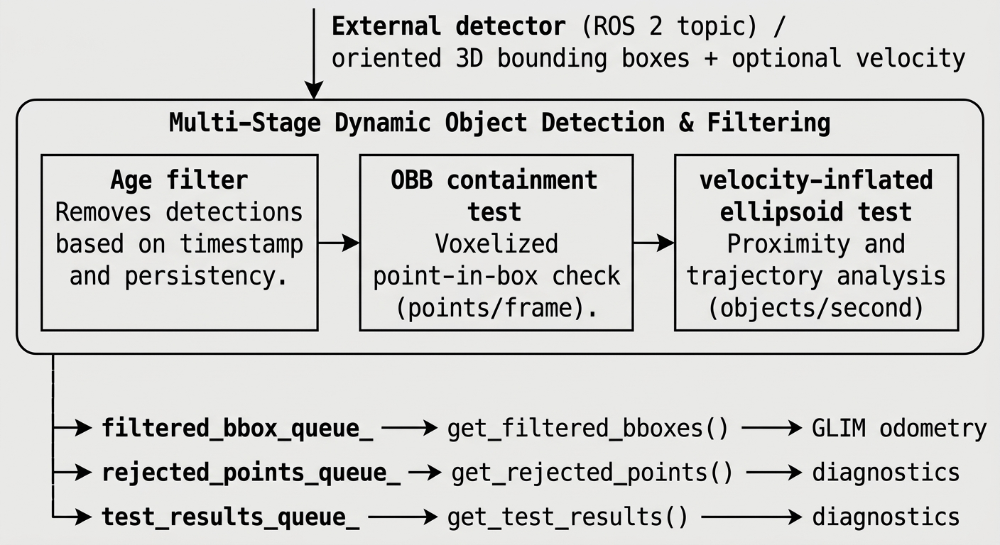
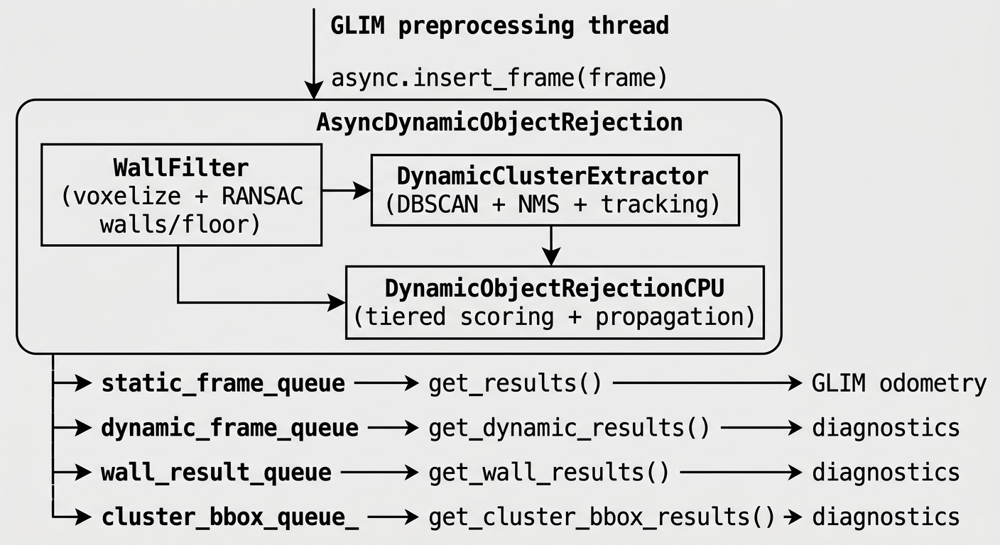

<p align="center">
  
</p>

<h1 align="center">FIDO-GLIM</h1>

<p align="center">
  <a href="https://giacomotambe.github.io/FIDO-GLIM/"><strong>📖 Full documentation</strong></a>
</p>

**FIDO** (Filtering and Identification of Dynamic Objects) is a dynamic object rejection framework integrated into [GLIM](https://github.com/koide3/glim), a 3D LiDAR-inertial SLAM system. FIDO intercepts raw LiDAR scans before they reach the GLIM odometry front-end, partitions each point cloud into a *static* subset (forwarded to GLIM) and a *dynamic* subset (retained for diagnostics), and thereby improves localization accuracy and map quality in environments containing moving objects.

---

## Overview

Most LiDAR SLAM pipelines assume a static world. In practice, pedestrians, vehicles, and other moving agents introduce transient measurements that corrupt scan matching and accumulate as ghost artifacts in the reconstructed map. FIDO addresses this with two complementary modules:

| Module | Mode | Description |
|--------|------|-------------|
| **Module 1 — Voxel-Based** | Autonomous | Geometry-driven pipeline: ground/wall filtering → DBSCAN clustering + tracking → per-voxel evidence (centroid shift, free space, vacated space) → per-object decision → point labels |
| **Module 2 — Bounding-Box** | Supervised | Consumes 3D bounding boxes from an external detector/tracker via ROS 2 topic and removes all enclosed points |

The two modules are independent and can be used separately or combined: Module 2 acts as a fast first-pass filter for confidently detected objects, while Module 1 handles residual or detector-missed dynamic content.

---

## How It Works

### Module 1 — Voxel-Based Pipeline ([full details](https://giacomotambe.github.io/FIDO-GLIM/module1_voxel.html))

The decision starts **per voxel** (local evidence of motion), is **aggregated per object** (clusters tracked over time) and goes back **to the points**:



1. **Pose of the scan** — from the IMU-fused `PoseKalmanFilter`, or, without IMU, extrapolated at constant velocity from the last stamped SLAM poses.
2. **Rejection frame** — a uniform sample of the raw scan (keeps the sensor's density profile) plus extra far points used only to decide.
3. **Static structure** — ground segmented every frame (polar grid + RANSAC), walls by vertical RANSAC kept in a persistent registry; structure is never dynamic.
4. **Clusters and tracks** — DBSCAN on voxels, fragment merge, constant-velocity prediction and Hungarian association.
5. **Voxel evidence** — centroid shift against 5 frames earlier beyond a range-dependent noise dead zone; points appearing where past scans saw free space (range images at t−6/10/14 and a world free-space map with DUFOMap-like dilation).
6. **Object decision** — enough dynamic voxels, plausible shape, motion and free-space evidence, or **vacated space** (the track's old position is now seen through). Tracks are confirmed by hysteresis or a leaky evidence accumulator; locks are released when the object stops or turns out to be static structure.
7. **Point labels** — only inside confirmed objects (feet kept, far ground returns dropped), with a guard against frames corrupted by a pose error; then transferred to GLIM's own points.

### Module 2 — Bounding-Box Pipeline ([full details](https://giacomotambe.github.io/FIDO-GLIM/module2_bbox.html))



Each box is kept active for a configurable number of frames (`max_bbox_frames`) to tolerate detector latency. When velocity is available, an asymmetric ellipsoid is inflated forward along the heading direction to cover the object's swept volume.

---

## Architecture ([full details](https://giacomotambe.github.io/FIDO-GLIM/architecture.html))

FIDO runs as a **producer–consumer** system decoupled from the GLIM preprocessing thread:



The pose of each scan comes from `PoseKalmanFilter`: an **error-state Kalman filter** that fuses IMU predictions with SLAM pose updates, or, without IMU, a **constant-velocity prediction** from the last stamped SLAM poses to the scan stamp.

---

## Dependencies

| Dependency | Notes |
|------------|-------|
| [GLIM](https://github.com/koide3/glim) | Base SLAM framework |
| ROS 2 (Jazzy or later) | Communication layer |
| GTSAM / gtsam_points | Factor graph, KdTree, point cloud types |
| Eigen 3 | Linear algebra |
| OpenMP or Intel TBB | Parallel per-voxel scoring (selectable at build time) |
| spdlog | Logging |

---

## Build

```bash
# Clone inside your ROS 2 workspace
cd ~/ros2_ws/src
git clone https://github.com/giacomotambe/FIDO-GLIM.git

# Build
cd ~/ros2_ws
colcon build --symlink-install

# Source
source install/setup.bash
```

---

## Configuration ([full reference](https://giacomotambe.github.io/FIDO-GLIM/parameters.html))

FIDO is configured through JSON files read at startup:

| File | Controls |
|------|----------|
| `config_dynamic_object_rejection.json` | Rejection frame, voxel evidence (shift, free space, vacated space), object decision, labelling |
| `config_dynamic_cluster_extractor.json` | DBSCAN, fragment merge, tracking, confirmation and locks |
| `config_wall_filter.json` / `config_wall_registry.json` | Voxel resolution, ground segmentation, wall RANSAC and registry |
| `config_bbox_rejection.json` | Velocity-inflated box zone (Modules 1 and 2), Module 2 box age |
| `config_ros.json` | `dynamic_rejection_type`: `NONE` · `CLUSTER` · `BBOX` · `COMBINED` |

**Before the first run**
- set `dynamic_rejection_type` (anything but `NONE` also makes the preprocessor keep the raw scan the rejection needs);
- `apply_lidar_imu_extrinsic` (both rejection files) is `true` only if `T_lidar_imu` in `config_sensors.json` belongs to your sensor;
- without IMU, use the CT odometry (`config_odometry_ct.json`).

### Key parameters (shipped defaults)

```json
// config_dynamic_object_rejection.json
"rej_input_points": 10000,              // uniform raw sample used by the rejection
"hybrid_min_range": 20.0, "hybrid_max_range": 40.0, "hybrid_max_points": 8000,
"compare_baseline_frames": 5,           // centroid shift against t-5
"noise_sigma0": 0.045, "noise_sigma_slope": 0.007, "noise_deadzone_k": 3.0,   // re-tune per sensor
"visibility_min_age": 6, "visibility_max_age": 14, "visibility_age_step": 4,  // past range images
"visibility_res_deg": 0.5,
"fs_enabled": true, "fs_res": 0.3, "fs_min_free": 5, "fs_dilate": 1,           // world free-space map
"vac_enable": true, "vac_gap_frames": 8, "vac_min_disp": 0.6,                  // vacated space
"cluster_propagation_threshold": 0.45,
"min_obj_height": 0.2, "max_obj_bottom_hag": 1.5, "max_obj_top_hag": 2.3,
"min_obj_vis": 0.3,
"frame_max_dynamic_frac": 0.1           // anomalous-frame guard

// config_dynamic_cluster_extractor.json
"eps_voxel_factor": 1.5, "cluster_max_range": 70.0,
"frag_merge_gap": 0.5, "frag_merge_gap_k": 0.02,
"assoc_gate_base": 0.8, "assoc_gate_per_range": 0.03,
"min_dynamic_frames": 2,
"track_evidence_decay": 0.8, "track_evidence_bias": 0.6, "track_evidence_on": 0.5,
"permanent_dynamic_frames": 8, "permanent_static_frames": 20
```

Every key, its status (active / option / legacy) and its meaning: [configuration reference](https://giacomotambe.github.io/FIDO-GLIM/parameters.html). How to adapt them to a new sensor: [tuning guide](https://giacomotambe.github.io/FIDO-GLIM/tuning.html).

---

## ROS 2 Interface

The ROS 2 node lives in [FIDO-GLIM-ROS2](https://github.com/giacomotambe/FIDO-GLIM-ROS2); topic names are set in `config_ros.json`.

### Subscriptions

| Topic | Type | Description |
|-------|------|-------------|
| `/imu/data` (`imu_topic`) | `sensor_msgs/Imu` | IMU measurements for ego-motion estimation |
| `/velodyne_points` (`points_topic`) | `sensor_msgs/PointCloud2` | LiDAR scans |
| `/onboard_detector/tracked_dynamic_obstacles` (`bbox_topic`) | detector boxes | External 3D bounding boxes for Module 2 |

### Publications

| Topic | Type | Description |
|-------|------|-------------|
| `/fido/static_points` | `sensor_msgs/PointCloud2` | Points classified as static (forwarded to GLIM) |
| `/fido/dynamic_points` | `sensor_msgs/PointCloud2` | Points classified as dynamic |
| `/fido/wall_points` | `sensor_msgs/PointCloud2` | Points belonging to detected wall planes |
| `/fido/cluster_boxes` | `visualization_msgs/MarkerArray` | Bounding boxes of detected clusters |

---

## Hardware Used

Experiments were conducted on an **AgileX Bunker Pro** tracked UGV equipped with:
- **LiDAR**: Velodyne VLP-16 (16 beams, ±15° vertical FoV, 10 Hz, ±3 cm accuracy)
- **IMU**: 6-DoF, rigidly co-mounted with the LiDAR
- **Software stack**: ROS 2 Jazzy, Ubuntu 24.04

FIDO runs entirely on CPU; GLIM uses the GPU for scan matching.

---

## Results

Point-level moving-object segmentation, labels evaluated on the full scan, with GLIM's own odometry in the loop (commit `30a4e05`, see [Evaluation](https://giacomotambe.github.io/FIDO-GLIM/evaluation.html) for protocol and the comparison with M-detector):

| Dataset | IoU < 20 m | IoU all |
|---|---|---|
| DOALS (8 sequences, mean per frame) | 74.8 | 71.7 |
| HeLiMOS KAIST05, Ouster OS2-128 (test split) | 0.616 | 0.561 |
| HeLiMOS KAIST05, Velodyne VLP-16 (test split) | 0.211 | 0.184 |
| SemanticKITTI 07 (frames 0–559) | 0.627 | 0.562 |

On 16-beam sensors recall is still low and there are almost no detections beyond 20 m.

The offline harness `kitti_dynamic_eval` (build with `-DBUILD_DYNAMIC_REJECTION_TESTS=ON`) reproduces these numbers on any sequence in SemanticKITTI layout.

---

## Cite

If you use FIDO-GLIM in your research, please also cite the original GLIM paper:

```bibtex
@article{koide2024glim,
  title   = {GLIM: 3D Range-Inertial Localization and Mapping with GPU-Accelerated Scan Matching Factors},
  author  = {Koide, Kenji and others},
  journal = {Robotics and Autonomous Systems},
  year    = {2024}
}
```

---

## License

This repository extends GLIM and inherits its license. See [LICENSE](LICENSE) for details.
