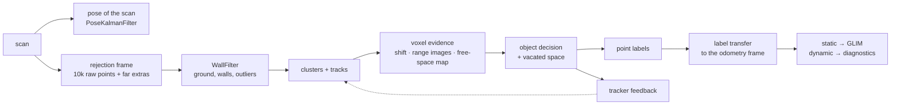

# Module 1 — Voxel pipeline

*Autonomous — needs no external detector.*

Module 1 splits every scan into a **static** frame (sent to GLIM odometry) and a **dynamic** frame (held back). The decision is built in three layers:

1. **per voxel** — local evidence of motion (centroid shift, free space, vacated space);
2. **per object** — voxels are grouped into clusters, clusters are tracked over time and confirmed dynamic only when the evidence holds;
3. **per point** — the object decision is written back to the points, and from the rejection's own sample onto the odometry frame.



Everything below runs inside `AsyncDynamicObjectRejection::run()`, in this order. Defaults are the values shipped in `config/`.

## 0 · Pose of the scan — `PoseKalmanFilter`

Every stage reads the pose of the current scan from `PoseKalmanFilter::getFramePose()` (times `T_imu_lidar` when `apply_lidar_imu_extrinsic` is true).

- **With IMU** — the filter integrates the IMU between SLAM updates; the pose is the IMU-propagated one.
- **Without IMU** — the filter keeps the last two *stamped* SLAM poses and extrapolates them at constant velocity to the scan stamp (`set_frame_stamp`), up to 1 s.

!!! warning "The pose of the current scan must be predicted"
    The rejection of scan *t* runs before odometry has processed *t*. If the pose is simply the last odometry pose (one scan behind, no prediction), static structure appears to move: on HeLiMOS IoU < 20 m drops from 72.8 to 62.4. Use an IMU, or stamped updates so the constant-velocity prediction kicks in.

## 1 · Rejection frame — `make_rejection_frame`

The rejection does not work on the odometry frame (which GLIM downsamples with a random grid). It builds its own input from the raw scan kept by the preprocessor:

| Step | Keys | Default |
|---|---|---|
| Uniform random sample of the raw scan (1–100 m), seeded by the stamp | `rej_input_points` | 10000 |
| Extra raw points far away, used only to decide (marked with time = NaN) | `hybrid_enabled`, `hybrid_min_range`, `hybrid_max_range`, `hybrid_max_points` | on, 20–40 m, 8000 |
| Past range images built from the raw scan | `vis_raw`, `vis_raw_max_range`, `vis_raw_max_points` | on, 70 m, 60000 |

A uniform sample keeps the sensor's density profile, which the evidence below depends on. At the end the labels are transferred back to the odometry frame (step 8), so GLIM still receives exactly its own points.

!!! note
    The preprocessor attaches the raw scan only when `dynamic_rejection_type` in `config_ros.json` is not `"NONE"` and one of `hybrid_enabled`, `vis_raw`, `fs_raw` is on. Without it, the three steps above silently fall back to the odometry frame.

## 2 · Static structure — `WallFilter`

`WallFilter::filter()` voxelizes the rejection frame once (`voxel_resolution`, 0.25 m, Gaussian statistics per voxel) and flags structure, which is never dynamic:

1. **Ground, every frame.** Polar grid over voxel centroids (10° sectors × 0.5 m bins); per sector a seed cell between 2 and 15 m, propagated inwards and outwards while the slope stays below `floor_polar_slope_threshold` and the height below `floor_polar_max_ground_height`. A RANSAC plane is then fitted to the ground voxels; its box defines `is_ground`.
2. **Walls.** Vertical 2-point RANSAC on the non-ground voxels (`wall_vertical_ransac`), up to `max_planes` planes. Wall planes are turned into oriented boxes and merged into the **`WallBBoxRegistry`**, which persists across frames (matched by normal, centre distance and OBB IoU; union of the boxes, thickness clamped to `max_wall_thickness`). Voxels inside a registry box get `is_wall`.
3. **Outliers.** Voxels behind a registry wall, seen from the sensor, get `is_outlier`.

Height above ground (HAG) for the later stages is computed separately: the lowest voxel centroid in the 3×3 block of `ground_cell_m` (2 m) cells around each voxel.

## 3 · Clusters and tracks — `DynamicClusterExtractor`

1. **DBSCAN on voxels** — non-structural voxels within `cluster_max_range` (70 m) and below `cluster_max_height` (4 m) above ground; neighbours found with a voxel hash; `eps = eps_voxel_factor × voxel_resolution` (0.375 m). `eps_range_k` optionally widens eps along *z* far from the sensor, for sparse rings (VLP-16 ≈ 0.04).
2. **Boxes** — one AABB per cluster, filtered by size (`bbox_min_extent` 0.1 m – `bbox_max_extent` 4 m) and volume.
3. **NMS**, then **fragment merge** — two boxes merge if their gap is < `frag_merge_gap + frag_merge_gap_k · r` (0.5 m + 0.02·r) and the union stays object-sized (`frag_max_len/wid/hgt` 6 × 3 × 4 m). The merged box remembers its **parts**, so points are later labelled only inside the parts.
4. **Tracking** — tracks are predicted at constant velocity; boxes are associated by **Hungarian assignment** on centroid distance, with gate `assoc_gate_base + assoc_gate_per_range · r + assoc_gate_per_missed · missed` (0.8 + 0.03·r + 0.3·missed), solved per connected component. Unmatched tracks coast for up to `track_max_missed` (5) frames.

A track is **confirmed dynamic** when any of these holds:

| Rule | Keys | Default |
|---|---|---|
| Consecutive dynamic frames (hysteresis) | `min_dynamic_frames` | 2 |
| Leaky evidence accumulator: `e ← decay·e + (evidence − bias)`, confirmed when `e ≥ on` | `track_evidence_decay`, `_bias`, `_on`, `_max` | 0.8, 0.6, 0.5, 2.0 |
| Locked state after N dynamic frames | `permanent_dynamic_frames` | 8 |

The accumulator confirms small or far objects that never pass the single-frame test, while the bias keeps the noise of static clusters out.

**Locks and their release.** After `permanent_dynamic_frames` (8) dynamic frames a track is locked dynamic; after `permanent_static_frames` (20) static frames it is locked static. Locks are not final:

- a static lock is released after `permanent_unlock_frames` (2) frames of strong motion (dynamic ratio > `unlock_ratio_factor` × threshold, or vacated space);
- a dynamic lock is released after `permanent_release_no_motion_frames` (3) matched frames without own motion — e.g. when the track has been handed over to a cabinet or a wall;
- a locked-dynamic cluster is not removed in a frame if it lies for ≥ `locked_struct_frac` (70%) on static structure of the free-space map (cells occupied for `struct_min_age` frames and never seen free since), or if its box is taller than `locked_max_height` (2.5 m).

## 4 · Voxel evidence — `DynamicObjectRejectionCPU`

The module keeps 14 frames of history (voxel maps, poses, range images). For every non-structural voxel above the ground band (`ground_band_m`, 0.25 m):

**a. Centroid shift against t−5** (`compare_baseline_frames`). The past voxel is found after ego-motion compensation, and the shift beyond a **noise dead zone** is scored:

```text
σ(r)  = min(noise_sigma_max, noise_sigma0 + noise_sigma_slope · r)
        + pose_err_trans_k · ‖t_baseline‖ + pose_err_rot_k · θ_baseline · r
score = w_shift · max(0, |shift| − noise_deadzone_k · σ(r)) / voxel_resolution
```

Defaults: σ0 0.045 m, slope 0.007, max 0.10 m, k = 3, `w_shift` 1.2. The σ model is sensor-specific and is the first thing to re-tune on a new LiDAR.

**b. Free space in past range images.** Each point is projected into the range images of the scans at t−6, t−10, t−14 (`visibility_min_age`, `_max_age`, `_age_step`; 0.5° cells, 3×3 minimum filter). If the sensor used to see farther along that ray (by more than `max(visibility_abs_thr, visibility_rel_thr · d)` = max(0.3 m, 3%)), the point now occupies space that was free. A strict majority of the scans that see the cell decides. The voxel's `vis` is the fraction of its points that appeared in free space.

**c. Free-space world map** (`fs_enabled`). A sharded hash grid in the world frame (`fs_res` 0.3 m) counts, frame after frame, how often each cell was crossed by a ray (free) or hit (occupied). A point is evidence of motion if its cell was seen free ≥ `fs_min_free` (5) times and ≥ `fs_free_ratio` (5) × occupied, **and** all 26 neighbours are free too (`fs_dilate`, a DUFOMap-like dilation — without it poles and edges are "emptied" by rays). It gives long memory without storing scans. `vis` becomes the maximum of (b) and (c). Rays are integrated in parallel, one every `fs_ray_stride` (4) points, up to `fs_max_range` (60 m).

**Score and thresholds.** `score += w_visibility · vis` (0.5); `score −= w_history · (fraction of the last frames where the voxel was static)` (0.3). The voxel is dynamic if the score passes a three-tier threshold on `dynamic_score_threshold` (0.08):

| Condition | Factor | Threshold |
|---|---|---|
| Inside a dynamic box (or its velocity-inflated zone) | `tier1_threshold_factor` 0.55 | 0.044 |
| Dynamic at t−1 | `memory_threshold_factor` 0.70 | 0.056 |
| Isolated | `unconstrained_threshold_factor` 3.0 | 0.24 |

A voxel with no match in the past is decided by free space alone. Dynamic voxels then add `w_neighbor` (0.2) to their 26 neighbours.

## 5 · Object decision — `propagate_to_clusters`

For each box: **ratio** = dynamic voxels / voxels, **vis** = mean free-space fraction. The cluster is dynamic in this frame if

- ratio > `cluster_propagation_threshold` (0.45), **and**
- shape is plausible: height ≥ `min_obj_height` (0.2 m), lowest point ≤ `max_obj_bottom_hag` (1.5 m) and highest ≤ `max_obj_top_hag` (2.3 m) above ground, **and**
- it moves: track speed ≥ `min_obj_speed` (0.1 m/s) or vis ≥ `moving_vis_alt` (0.3), **and**
- it was seen in free space: vis ≥ `min_obj_vis` (0.3);

**or** it passes the **vacated-space** test (`vac_enable`): the points the track occupied ≥ `vac_gap_frames` (8) frames ago, after a displacement ≥ `vac_min_disp` (0.6 m), are now seen through by the current scan (≥ 80% of the visible ones, ≥ 4 points), with a constant-velocity check on the midpoint. This catches objects whose own points carry little evidence.

This per-frame verdict is fed back to the tracker (step 3). A box is **removed** in the current frame only if its track is already confirmed, or by **fast confirmation** (ratio > 2 × threshold and vis ≥ 0.2).

Optional, off by default: **delayed decision** (`fut_delay` > 0) — wait D frames and also test the points against the *future* range images. On HeLiMOS `fut_delay: 10` raised IoU < 20 m by about 2 points, at the cost of 1 s of latency (offline mapping only).

## 6 · Point labels

- Voxels inside the parts of a removed box → dynamic. A foot rule keeps near-ground voxels (HAG ≥ `foot_min_hag`, 0.10 m) under a tall confirmed box dynamic.
- Voxels in the velocity-inflated zone of a dynamic box (`config_bbox_rejection.json`) or in recent boxes of confirmed tracks → dynamic **only with their own evidence** (`inflated_requires_evidence`).
- Beyond `point_ground_cut_min_range` (10 m), points less than `point_ground_cut` (0.2 m) above ground stay static: they are ground returns inside the box.
- Everything else is static: at default the output is decided per object, never by isolated voxels.
- **Anomalous-frame guard**: if more than `frame_max_dynamic_frac` (10%) of the points come out dynamic — typically a pose error — only the bases of confirmed objects are kept dynamic.

## 7 · Memory update

The voxel map, pose and range image of the frame enter the history (14 frames); the scan is integrated into the free-space map (after the query, so a scan never votes on itself).

## 8 · Label transfer — `transfer_labels`

The labels found on the rejection frame are copied onto the odometry frame: each odometry point takes the label of its nearest labelled point within `label_transfer_radius` (0.5 m), static on ties and when nothing is within reach. The static frame reuses the preprocessing neighbours wherever possible, so GLIM's covariance estimation is not repeated.

## What changed from the first version

The first version scored each voxel against the previous frame only (`w_shift`, `w_cluster`, `w_distance`, ego-motion-scaled thresholds) and propagated a cluster as soon as its dynamic ratio crossed a threshold. The current pipeline adds the noise dead zone, free space (range images and world map), vacated space, Hungarian tracking with evidence accumulation and lock release, the separate uniform rejection frame and label transfer, and the pose prediction without IMU. The legacy keys are still read but set to 0 — see [Configuration reference](parameters.md#legacy-and-experimental-keys).
